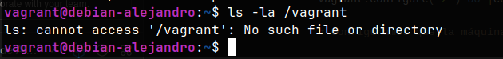
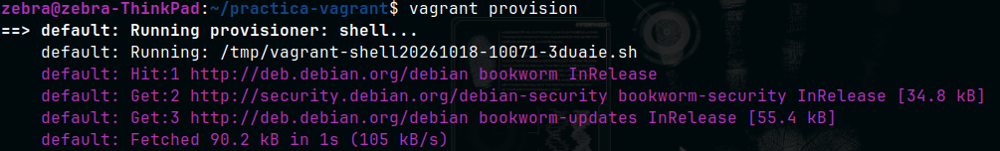

# Tarea 1.1.2 - Vagrant

# Qué es Vagrant?

Vagrant es una herramienta de código abierto que fue desarrollada por HashiCorp que nos permite crear y gestionar entornos de desarrollo virtualizados de forma rápida y sencilla.

**Qué hace?:** Crea una capa por encima de la virtualización con la que podemos automatizar la configuración y creación de máquinas virtuales.

**El problema que resuelve**: evita el problema de "en mi ordenador si funciona tío" nos permite describir toda la configuración de un servidor en un archivo, y si alguien descarga el proyecto y ejecuta Vagrant, tendrá el mismo entorno que el servidor. Con esto evitamos que algo funcione en una máquina y en otra no funcione.

## Conceptos

- **Anfitrión (Host):** El ordenador físico donde estás y donde instalas Vagrant.
- **Proveedor de virtualización:** Es el software que hace el trabajo de crear la máquina, es decir un hipervisor (VirtualBox o VMware).
- **Box:** Es una imagen base (como una plantilla) que Vagrant va a usar para construir la máquina virtual (Debian en mi caso).
- **Máquina Virtual (VM):** Es el SO virtualizado donde ejecutamos un sistema distinto dentro de nuestro equipo, comparte los recursos (CPU, RAM…) con nuestro equipo y funciona como un SO independiente.
- `Vagrantfile`: está escrito en el lenguaje de programación **Ruby,** es el archivo de configuración dónde se configura la máquina y se especifica sus características.

# Aprovisionamiento

- **Qué es un provisioner**? Es una herramienta o script con la que automatizamos la instalación de software (como el Apache que vamos a instalar) y la configuración del sistema operativo una vez que la máquina ha arrancado.
- **Dónde y cuándo se ejecuta**: Se ejecuta dentro de la máquina virtual, Vagrant lo ejecuta automáticamente durante el primer `vagrant up`.
- **Diferencia entre inline y path**:
    - `inline`: El script o los comandos se escriben dentro del mismo archivo Vagrantfile.
    - `path`: Con este se indica la ruta a un archivo externo (`script.sh` guardado en la misma carpeta), es mucho más limpio.
- **Si modificas el script**: Si cambias algo en el script después de que la máquina ya se haya creado, `vagrant up` no hará nada, para que los cambios sean efectivos y se vuelva a ejecutar debes usar el comando `vagrant provision` o `vagrant reload --provision` esto también reiniciaría la máquina.

# Interfaces y Redes

- **Red por defecto**: Vagrant configura automáticamente una red NAT, la utiliza para darle Internet a la máquina virtual y permitir que el host se pueda conectar con SSH.
- **Tipos de redes**:
    - **NAT:** La máquina sale a Internet a través de tu PC pero nadie más puede verla.
    - **Red Interna (VirtualBox):** Permite la comunicación entre máquinas virtuales, están completamente aisladas del host y de fuera.
    - **Red Privada Host-only de VMware:** Crea una red local cerrada que conecta las máquinas virtuales y también al **anfitrión**, viene bien para hacer pruebas con tu PC.
    - **Red Pública (Puente):** La máquina virtual se conecta al router de tu LAN como si fuera otro dispositivo más, recibiendo su IP y siendo visible en la red.
- **Reenvío de puertos:** No crea una interfaz de red nueva, solo añade una regla de enrutamiento a la interfaz NAT que ya existe. Nos permite poder mapear puertos de la MV como el 80 de HTTP (ej lo que vamos a usar en Apache), a un puerto libre de nuestro PC como el 8080, así podríamos acceder desde nuestro PC a la web.
- **Segunda interfaz**: Añadir una segunda interfaz no elimina esta NAT predeterminada, y sigue pudiendo salir a Internet, se añade como otro adaptador más.

# Ordenes y carpeta compartida

| Comandos | Cuándo lo usaría? | Llegué a ejecutarlo? |
| --- | --- | --- |
| `vagrant up` | Para crear y arrancar la MV por primera vez o para encenderla si estaba apagada | Si |
| `vagrant status` | Para comprobar el estado de la MV: en ejecución, apagada, no creada... | Si |
| `vagrant ssh` | Para abrir una terminal y entrar a administrar la máquina virtual. | Sí, para comprobar el estado de Apache |
| `vagrant reload` | Para reiniciar la MV, útil si hacemos cambios en el Vagrantfile y necesitamos aplicarlos. | Si |
| `vagrant provision` | Para volver a ejecutar los scripts de config sin tener que reiniciar la MV. | Si |
| `vagrant halt` | Para apagar la MV de forma segura. | Si |
| `vagrant destroy` | Para borrar por completo la MV y liberar el espacio del disco duro. | Sí, usando -f cuando falló el clon de VMware |

**¿Qué es `/vagrant`?** Es una carpeta compartida por defecto dentro de la MV, tiene exactamente el mismo contenido que tienes en la carpeta de tu PC host donde guardas el `Vagrantfile`, es útil porque los scripts o archivos que pongas junto al `Vagrantfile`en el anfitrión aparecerán automáticamente allí dentro.   



Durante la ejecución con VMware Workstation Pro y el box generic/debian12, hemos comprobado con la terminal que el comando `ls /vagrant` no muestra los archivos porque la sincronización nativa está hehca para las Guest Additions de VirtualBox, en VMware el montaje HGFS a veces necesita instalar manualmente `open-vm-tools` y forzar protocolos alternativos como `rsync` o `smb` en el Vagrantfile para que la carpeta se sincronice bien.

# Esquema de Red


# Configuración del Vagrantfile

Procedemos a crear el archivo `Vagrantfile`, he utilizado la imagen oficial `generic/debian12`, ya que ofrece compatibilidad nativa con VMware y evita el error que nos daba `debian/bookworm64` que no era compatible con VMware.

## Código

Explicación de nuestro Vagrantfile:

```ruby
Vagrant.configure("2") do |config|

# Configuramos que la máquina virtual va a ser Debian 12 (compatible con VMware), lo podemos comprobar con `cat /etc/os-release`
config.vm.box = "generic/debian12"

# Asignamos nuestro nombre a la máquina, lo podemos comprobar con `hostname`
config.vm.hostname = "debian-alejandro"

# Esto es una configuración específica para VMware, desactiva clones enlazados para evitar errores de snapshots
config.vm.provider "vmware_desktop" do |v|
  v.linked_clone = false
end

# La interfaz 1, Vagrant configura una red NAT por defecto para salida a Internet y SSH.
# La interfaz 2, Red privada (Host-only) con IP estática como nos pide la práctica, lo podemos comprobar con `ip a` 
config.vm.network "private_network", ip: "192.168.56.10" 

# Aquí configuramos el reenvío de puertos, del 80 (invitado) al 8080 (host), limitado a localhost, lo podemos comprobar accediendo a la web desde el host usando [http://127.0.0.1:8080](http://127.0.0.1:8080)
config.vm.network "forwarded_port", guest: 80, host: 8080, host_ip: "127.0.0.1"

# Aquí indicamos la ruta de nuestro script de aprovisionamiento, lo podemos comprobar con `systemctl status apache2`
config.vm.provision "shell", path: "instalar_apache.sh"
end
```

# Muestra del script de aprovisionamiento

```bash
#!/bin/bash

# Antes de instalar apache vamos a actualizar los repositorios y luego instalaremos apache
apt-get update
apt-get install -y apache2

# Iniciamos y habilitamos el servicio de apache
systemctl start apache2
systemctl enable apache2

# Creamos la página de inicio con el hostname dinámico
echo "<h1>Servidor web de Alejandro</h1><p>Hostname de la maquina: $(hostname)</p>" > /var/www/html/index.html
```

# Pruebas de funcionamiento y capturas

## Verificación Apache2

Accediendo mediante SSH (`vagrant ssh`), comprobamos que el servicio web está activo y funcionando.


## Verificación del reenvío de puertos

## Interfaces

Aquí enseño ambas interfaces una en modo `NAT (eth0 —> 192.168.194.131)` y otra en `Red Privada (eth1 —> 192.168.56.10)`


## Verificación desde el host

Desde el navegador del host (en mi caso Ubuntu), comprobamos que la regla de reenvío de puertos funciona perfecto al acceder a `http://127.0.0.1:8080.` Podemos ver la página HTML hecha por el script de aprovisionamiento, enseñando el nombre correcto y el hostname de la máquina.


## Re-ejecución del aprovisionamiento (`vagrant provision`)

Para comprobar qué ocurre al modificar el script `instalar_apache.sh` una vez que la máquina ya está creada y encendida, editamos el mensaje del archivo `index.html` dentro del script. 

Como Vagrant solo ejecuta el aprovisionamiento automáticamente en el primer `vagrant up`, lanzamos desde la terminal del host el comando:
```bash
vagrant provision
```


# Incidencias y resoluciones

En el desarrollo de la práctica de mi host (Ubuntu 24.04 con Kernel 7.0.0-38-generic), nos encontramos con varios bloqueos que investigamos y adaptamos de la configuración inicial.

### Incompatibilidad del módulo DKMS de VirtualBox ([vboxdrv.sh](http://vboxdrv.sh/): failed)

- **Problema**: Al intentar usar VirtualBox como proveedor, la compilación de los módulos del núcleo fallaba por la falta de soporte del código fuente de VirtualBox 7.0 para la versión tan reciente del kernel de Linux del equipo host(7.0.0-38).
- **Solución**: Para la estabilidad del entorno usamos VMware Workstation Pro, gestiona mejor los kernels recientes.

### Error de comunicación con el hipervisor VMware (Failed to open TCP connection to 127.0.0.1:9922)

- **Problema**: Vagrant daba un error de conexión al intentar levantar la máquina con --provider=vmware_desktop ya que no había servicio puente.
- **Solución**: Se instaló el plugin (`vagrant plugin install vagrant-vmware-desktop`) y el servicio (`sudo apt install vagrant-vmware-utility`).

### Imagen base no encontrada (Box 'debian/bookworm64' could not be found)

- **Problema**: El box oficial (`debian/bookworm64`) solo está para VirtualBox y Libvirt en Vagrant Cloud, por lo que fallaba al usar VMware.
- **Solución**: Se modificó el `Vagrantfile` para utilizar la imagen `generic/debian12`, esta versión tiene el mismo sistema operativo base (Debian 12 Bookworm) pero está compilada por la comunidad para ser compatible con todos los proveedores, también VMware.

### Error de Snapshot y dependencias obsoletas en Ubuntu 24.04

- **Problema**: Al crear la máquina VMware daba el error `The operation is not supported` al intentar hacer un snapshot, y Vagrant fallaba al verificar la red porque no encontraba el comando `netstat`, y el sistema pedía la librería `libaio1`.
- **Solución**: Se desactivaron los clones enlazados en el `Vagrantfile` añadiendo `v.linked_clone = false` dentro de la configuración, y se instalaron las herramientas de red clásicas (`net-tools`) y la versión actualizada de la librería para Ubuntu 24.04 (libaio1t64), permitiendo a Vagrant mapear la red correctamente.

# Bibliografía y Referencias

- **Apuntes del curso en Moodle**. [Apuntes IAW](https://informatica.iesalbarregas.com/course/view.php?id=106)
- **Documentación Oficial de Vagrant (HashiCorp)**:
    - [VMware Provider & Vagrant VMware Utility](https://developer.hashicorp.com/vagrant/docs/providers/vmware)
    - [Vagrantfile y Shell Provisioning](https://developer.hashicorp.com/vagrant/docs/provisioning/shell)
- **Wiki Oficial de Debian**:
    - [Apache2 Web Server](https://wiki.debian.org/Apache)
